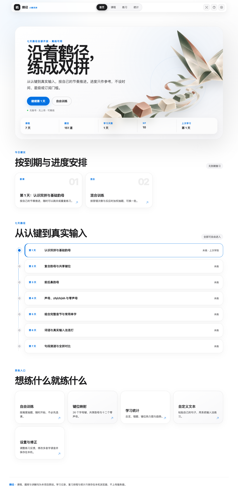
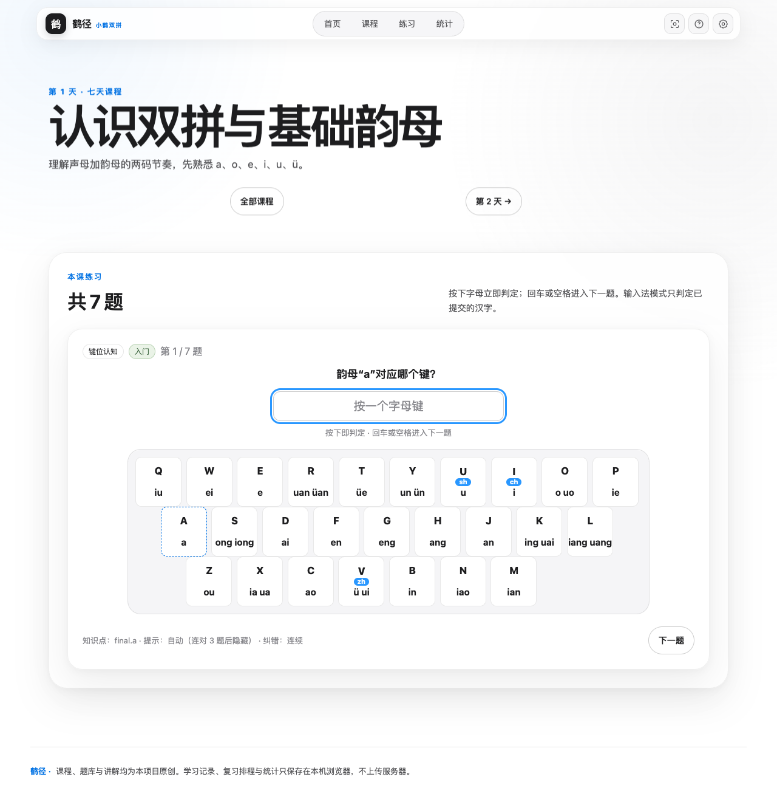
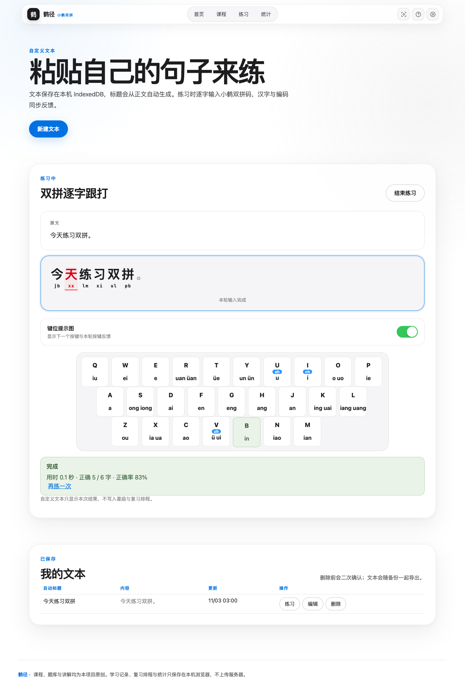
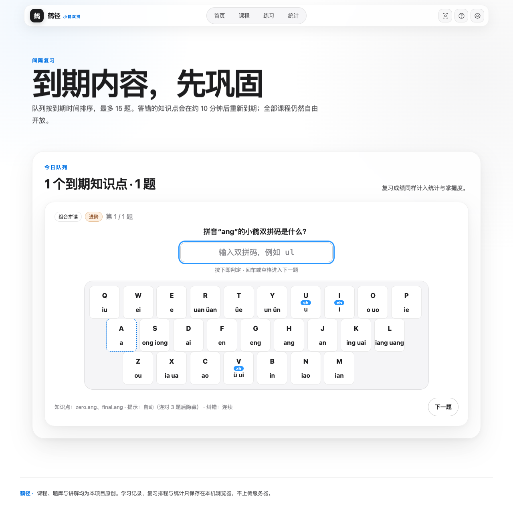
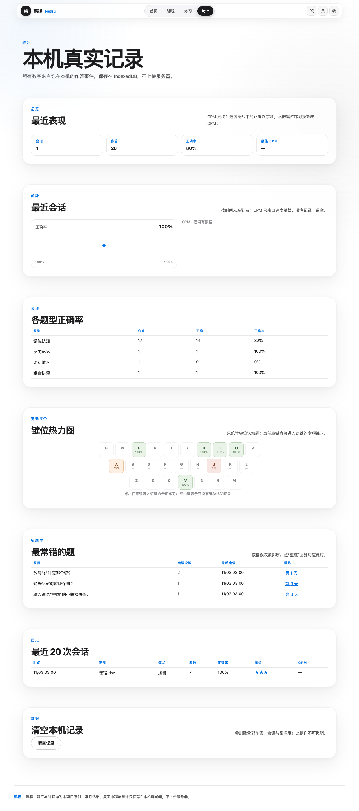
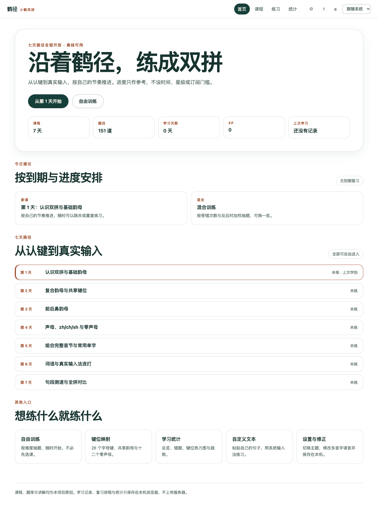

<div align="center">

# 鹤径 · 小鹤双拼学习器

**从认识键位到逐字跟打，用 7 天开放路径建立稳定的双拼输入节奏。**

离线优先 · 151 道原创练习 · 错题复习 · 真实统计 · 自定义文本逐字跟打

</div>



## 小鹤双拼是什么，为什么值得学？

全拼需要把一个音节的全部字母依次打完；双拼把声母和韵母分别映射到键盘上，大多数音节稳定为两次按键。例如：

- `双 shuang`：`sh → U`，`uang → L`，输入 `ul`
- `拼 pin`：`p → P`，`in → B`，输入 `pb`

小鹤双拼的优势不是“背完立刻变快”，而是把长短不一的拼音压缩成更稳定的两键节奏：手指移动更少、音节边界更清楚，熟练后更适合长时间连续输入。它的键位资料成熟，macOS 也提供内置小鹤双拼布局。

鹤径希望解决最难的那一段过渡：**知道双拼好用，却不知道怎样从键位记忆走到真实输入。**

## 15 秒看懂鹤径


[下载清晰 MP4 演示](docs/showcase/hejng-demo.mp4)

演示依次展示：首页学习路径、练习中心、粘贴自定义文本，以及汉字和双拼码逐字对错反馈。

## 它能帮助你做到什么？

- 用 7 天开放课程从基础韵母、共享键位、声母和零声母逐步走到词句输入。
- 通过屏幕键盘看见“下一个该按什么”，熟练后逐渐关闭提示。
- 答错后立即看到错误键位，并通过错题回插和间隔复习反复巩固。
- 粘贴自己的中文内容，直接进行逐字小鹤双拼跟打。
- 用真实作答记录查看正确率、学习天数、薄弱键位、趋势和 CPM。
- 安装为 PWA 后离线学习；课程、词典、进度和统计都保存在本机。

## 页面导览

### 1. 首页：今天该练什么，一眼就知道

首页把继续学习、今日建议、七天路径和自由入口放在同一条视觉动线上。课程全部开放，不需要签到、订阅或逐关解锁。


### 2. 课程练习：按键即判定，反馈不打断节奏

题目、输入区和键位图保持在同一视野。按下字母后立即判断；正确键、错误键和下一个提示键都有独立状态，支持自动切题、严格纠错和连续纠错。



### 3. 自定义文本：把你真正想打的内容变成练习

粘贴中文后，标题会自动生成。练习区上方保留原文，下方汉字先淡显：

- 输入正确：汉字和双拼码恢复正常加粗颜色；
- 输入错误：对应汉字与双拼码显示红色；
- 双拼字母位于汉字下方并逐键出现；
- 键位提示图可随时开启或关闭；
- 离线词典会结合词语上下文处理常见多音字。



### 4. 到期复习：把练过变成记住

系统根据本机掌握度生成到期队列，优先安排需要回看的知识点。课程仍然完全开放，计划是建议而不是门槛。



### 5. 统计与热力图：只展示真实作答数据

统计页读取 IndexedDB 中的真实练习事件，展示正确率、趋势、错题和 26 键热力图。点击薄弱键可以直接进入专项练习。



### 6. 窄屏可访问

首页、课程路径和主要设置支持窄屏浏览；物理键盘训练仍建议在桌面设备上完成。

<p align="center">
  
</p>

## 两个版本

| 版本 | 获取方式 | 特点 |
|---|---|---|
| V1 · WorkBuddy 完成版 | Git 标签 `v1-workbuddy` | 完整学习闭环、纯白界面、纵向七天路径和 56 项浏览器回归 |
| V2 · 设计增强版 | `main` / Git 标签 `v2.0.0` | Apple 式浅色视觉、原创鹤主题首页、自定义文本逐字双拼、移动端修正与完整图文素材 |

V1 首页留档：



## 快速开始

环境要求：Node.js 22.12 或更高版本。

```bash
npm install
npm run build
npm run preview --workspace @xiaohe/trainer
```

浏览器打开 `http://127.0.0.1:4174/`。

也可以使用：

- macOS：双击 `release/start-macos.command`
- Windows：运行 `release/start-windows.bat`
- PWA：在支持的浏览器中选择“安装应用”，完成首次缓存后可断网使用

## 推荐学习方式

1. 先完成第 1～4 天，建立韵母、共享键位、声母和零声母的基本映射。
2. 保持键位提示图开启，先追求正确，不急着追求速度。
3. 能稳定输入后切换“按下后显示”或关闭自定义文本的键位提示。
4. 用到期复习和热力图针对薄弱键位练习。
5. 粘贴自己常写的句子逐字跟打，再用速度挑战观察长期变化。

实际速度提升取决于练习量、输入法设置和个人习惯；项目不会用少量练习结果夸大“已经掌握”。

## 隐私与离线

- 不需要账号，没有订阅门槛。
- 学习记录、错题、自定义文本和读音修正只保存在本机浏览器。
- 不调用在线拼音 API，不上传个人练习文本。
- 支持 JSON 备份导出、事务导入和本机数据清空。

## 测试与质量

```bash
npm run test:all     # 学习器 197 项 + 协调器 35 项
npm run verify:ui    # 56 项真实 Chromium 浏览器回归
npm run typecheck
npm run build
```

覆盖范围包括：小鹤编码、零声母、多音字、逐字跟打、IME composition、IndexedDB、备份迁移、统计、窄屏、Service Worker 离线刷新与控制台错误。

## 项目结构

```text
apps/trainer/       React + TypeScript 离线学习器
apps/coordinator/   本地 Agent 接力协调器
docs/               需求、架构、测试报告与图文素材
release/            macOS / Windows 启动入口
scripts/            UI 回归、静态服务与演示录制
```

详细资料：

- [需求规格](REQUIREMENTS.md)
- [七天课程](CURRICULUM.md)
- [技术架构](ARCHITECTURE.md)
- [测试报告](docs/TEST_REPORT.md)
- [V2 设计审查](docs/V2_DESIGN_REVIEW.md)
- [版本决策覆盖](docs/DECISION_OVERRIDES.md)
- [打包与离线说明](docs/PACKAGING.md)

## 当前边界

- 真实系统 IME、Windows 启动流程、PWA 安装弹窗和屏幕阅读器仍需要更多真机覆盖。
- 极少数字若离线词典无法生成可支持的小鹤编码，会保留显示并跳过输入。
- 本地 Agent 协调器仍有系统重启恢复等 G5 测试未完成，不影响学习器使用。
- 本项目课程、题库、文案与 UI 为独立创作；不包含 KeySpell 会员内容或受保护素材。

---

如果鹤径帮你跨过了双拼学习最难的起步阶段，欢迎在 GitHub 留下反馈、问题或你的练习体验。
