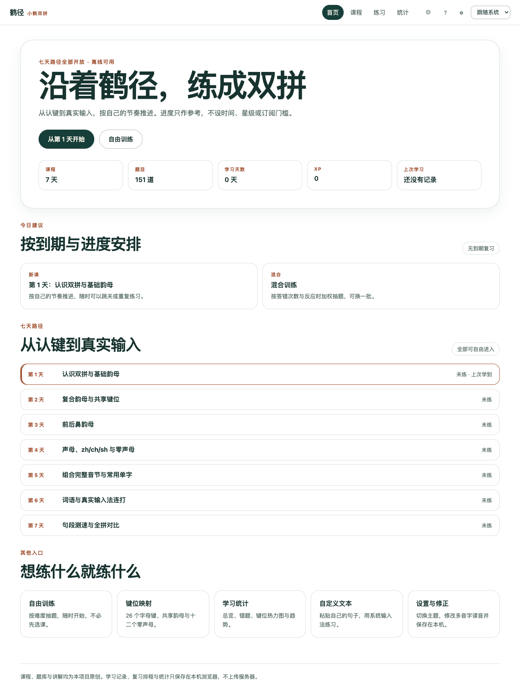

# 鹤径 V1 · 完整学习闭环

V1 是 WorkBuddy 完成的首个可运行版本，建立了从课程、练习到复习与统计的完整闭环。

## 主要能力

- 7 天开放课程与 151 道原创题目
- 物理键按下即判定，键位图同步反馈
- 自由训练、到期复习、薄弱加权和速度挑战
- IndexedDB 本地记录、错题本、热力图与趋势
- PWA 离线缓存、备份导出与事务导入
- 197 项单元测试和 56 项真实浏览器检查

获取版本：Git 标签 `v1.0.0` 或兼容标签 `v1-workbuddy`。
