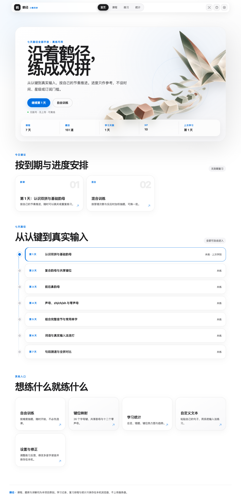
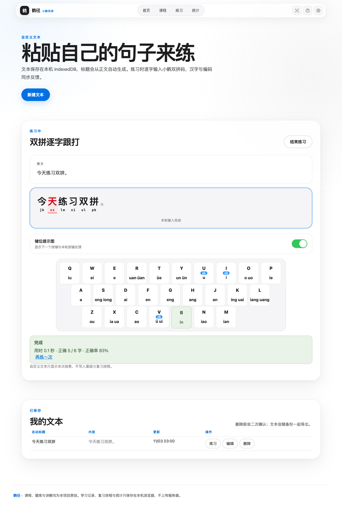

# 鹤径 V2 · 设计增强与逐字跟打

V2 保留 V1 的全部学习能力，重新设计视觉层级，并把自定义文本升级为真正的逐字小鹤双拼练习。

## 相比 V1 的变化

- Apple 新品页式浅色视觉、悬浮导航与原创鹤主题首页
- 桌面、平板和窄屏布局优化
- 自定义文本自动生成标题
- 离线上下文拼音解析与逐字小鹤编码
- 汉字和双拼字母对齐显示，正确加粗、错误标红
- 可开关的实时键位提示图
- 页面按需拆包，同时保持 Service Worker 完整离线缓存
- 新增 GitHub 图文说明、15 秒 GIF 和 MP4 演示

获取版本：默认分支 `main` 或 Git 标签 `v2.0.0`。
